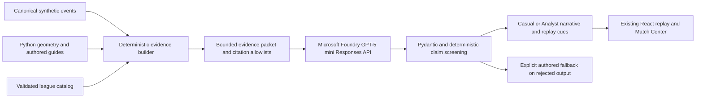

# Phase 4 — Foundry intelligence

Implementation date: October 26, 2026 (America/Toronto). No commit or push requested.

This report records Phase 4 and its v2 prompt follow-up, including historical live-call results. The current v3 prompt and Match Center presentation are documented in [Phase 4.1](PHASE_4_1_AI_MATCH_CENTER.md); its human-readable evidence disclosure supersedes the older UI labels and recap layout described here.

## Contracts discovered before implementation

- FastAPI registers independent tactical and league routers. Pydantic contracts generate `backend/openapi.json` and `frontend/src/api/schema.d.ts`.
- `tactics.service.REGISTRY` owns three unchanged canonical sources. `EvidenceBundle` provides source SHA-256, computed observations/metrics/units, separately marked authored interpretations, and `precedes_not_proven_cause` chains. The geometry engine remains authoritative.
- `league.service.get_catalog()` validates fictional fixture scores, roster identities and event-to-replay mappings. Match event IDs differ from canonical replay event IDs. Replay time is relative; match time is `matchStartSeconds + replay time`.
- Three finished fixtures each reference one reconstructed passage. Other match events are metadata only. Two upcoming fixtures have neither events nor final scores.
- `ReplaySession` owns scene reset and cleanup. Zustand supplies the single authoritative clock. DOM displays sample it through `useReplayTime`; scene world state never comes from an AI timer.
- The frontend uses generated contracts, abortable requests and keyed resources. AI features will extend these patterns and preserve the existing global fixture strip.
- Baseline working tree includes existing changes to league navigation, studio composition, styles and tests, plus `GlobalFixtureStrip.tsx` and its browser tests. Those changes are preserved.
- OpenAI SDK was absent; added official `openai` SDK (resolved 2.54.0). Existing Pydantic Settings supports backend-only dotenv loading. The Foundry skill dependency check reports absent `azd`; SDK use of the already deployed model requires no Azure CLI or new resources.

## Design

Use a single model workflow: deterministic evidence builder → Foundry structured narrative → deterministic validator → presentation adapter. This is not independent multi-agent collaboration. Source excerpts and quantities are server-owned; generated prose is qualitative, cited, screened for unsupported claims, and always labeled as interpretation. Explicit mock mode and validation fallback have distinct provenance.

Generate only on user action. Bound requests, retries, concurrency, input/output size and process-local caches. Commentary generation happens outside replay sampling. Preserve the dark broadcast palette, existing typography and lime controls; put concise intelligence beside the action, with technical evidence in disclosure controls.

## Implemented workflow and Microsoft's role



`MicrosoftFoundryProvider` uses the official asynchronous OpenAI SDK against the existing Azure `/openai/v1/` endpoint. The deployment is the backend configuration's `gpt-5-mini`; no additional Azure resources, agent frameworks, databases, telemetry, speech services or hosting were created. Responses use Pydantic structured output, `reasoning.effort=minimal`, bounded output tokens, `store=False`, explicit timeouts and SDK retries disabled in favor of the application's bounded retry policy. No temperature parameter is sent.

The evidence builder, verifier and presentation adapter are ordinary deterministic code. There is **one LLM role**, narrative generation. This is purposeful orchestration with testable boundaries, **not independent multi-agent collaboration**. A second model/critic and a Microsoft Agent Framework deployment remain proposed; neither is necessary for this slice.

Official references consulted through Context7 and Microsoft Learn:

- [Azure Responses API](https://learn.microsoft.com/azure/foundry/openai/how-to/responses)
- [Azure structured outputs and supported models](https://learn.microsoft.com/azure/foundry/openai/how-to/structured-outputs)
- [Azure reasoning-model parameters](https://learn.microsoft.com/azure/foundry/openai/how-to/reasoning)
- [Official Python SDK structured parsing helper](https://github.com/openai/openai-python/blob/main/helpers.md)
- [React effect cleanup and stale-response handling](https://react.dev/learn/synchronizing-with-effects)

## Trusted packets and validation policy

`ai/evidence.py` resolves scenario-to-match mappings from the existing validated catalog. It sends event/player/team identities, replay and match clocks as distinct fields, stable source IDs, at most two selected computed observations per target event, measurement units, separately labeled authored interpretations, verified match metadata, synthetic-data limitations and explicit per-target citation allowlists. It does not send full player tracks or recalculate geometry. Source SHA-256, evidence-bundle hash, evidence version, geometric thresholds and the packet-content hash protect provenance and cache invalidation. The full evidence hash includes metric definitions and assumptions even when compact excerpts are unchanged.

For the dummy, the exact non-contact and no-possession-transfer semantics come from the canonical dummy event. Centre proximity comes from the existing Python observation and cannot establish body clearance. Linked pass/reception citations are allowed through measured event links; an unrelated shot citation is rejected.

Four source kinds remain explicit throughout the API and UI:

| Source kind | Meaning |
| --- | --- |
| `recorded_event` | Authored canonical synthetic event, never observed professional tracking |
| `measurement` | Exact Python-produced observation, evidence ID and units |
| `authored_interpretation` | Existing author's tactical reading, labeled separately |
| `match_metadata` | Verified fictional result/event ledger; no invented reconstruction |

Generated output is Pydantic-validated, must match the exact ordered target IDs, and can cite only known, allowed sources. A per-packet Pydantic generation schema restricts event/source IDs to known literal enums before decoding; post-generation checks still enforce event relevance and required citations. Every narrative must cite its recorded event. Recaps must also cite the recorded final score. Analyst output must cite at least two relevant computed observations when available. Identical repeated citations are normalized without adding support; unknown/unrelated references fail validation, and the raw validator also rejects duplicate IDs. This normalization never invents evidence or repairs prose.

Generated prose is qualitative. Digits and common spelled-out quantities are rejected; scores and measurements are displayed only through immutable backend excerpts. Screening also rejects common assertions of intent, awareness, deception, hesitation, exaggerated causality, probabilities, invented counterfactuals, ratings and expected goals, along with HTML/link markup. The model cannot supply its own evidence statements: `key_evidence` is resolved from trusted sources after validation. React renders ordinary text and escapes it; no generated HTML is inserted.

Rejected output produces a deterministic authored fallback with `provider=validation_fallback`; offline fixtures use `provider=mock`. Neither is presented as a successful live AI response. Connection, quota and configuration failures remain helpful errors with the replay still usable; they do not silently switch to mock. The UI labels live content as AI-generated interpretation. The deterministic confidence label is `references-and-claims-screened`, not a percentage or a claim that prose has been proven true.

**Limitations:** lexical screening is deliberately conservative and can reject harmless wording, including negative caveats. It is not a general semantic entailment checker: paraphrased unsupported qualitative claims, unusual written quantities or invented names in prose may escape it. Valid citation IDs do not prove every sentence. Exact numerical excerpts and reference identity have stronger guarantees than natural-language interpretation. No success probabilities, counterfactual simulations, observed attention or causal proof were added. Further semantic evaluation would require a separately scoped evaluation set; no large paid evaluation was run.

## Viewer experience and mode differences

In Replay Studio, **Inside the play** sits beneath replay controls, keeping the pitch and existing player inspection panel central. Select a canonical moment or use the current replay event, then choose **Explain this moment**. Loading/error/retry states, Casual Fan/Analyst controls, collapse, source labels and **Why this explanation?** disclosures are integrated with the existing dark broadcast design.

The current `phase4-v2` prompt asks Casual for two to four short conversational sentences about the recorded action. Analyst asks for about four concise sentences about the supported movement chain, spatial relationships and finish, and requires additional measurement references. Both modes keep exact measurements, units, source IDs, definitions and limitations in the initially closed **Why this explanation?** disclosure. The football explanation stays visible first. Both use the same authoritative facts. Mock fixtures differ in content and depth too, so mode behavior is testable offline.

Measured references offer **Show supporting replay**, loading the existing source-validated evidence bundle and invoking the existing guided replay controller. No replacement overlay or second camera controller was introduced. Requests abort on mode/route/scenario changes; keyed resources hide old content immediately, and evidence replay actions have their own cancellation guard. Global fixture navigation retains its existing ownership/reset behavior. Controls use semantic buttons/selects/disclosures, visible focus, keyboard support, practical touch targets and reduced-motion styling. Mobile checks use browser emulation, not physical devices.

## Synthetic ingestion and commentary synchronization

`event_stream()` deterministically orders canonical events by replay timestamp with stable canonical tie ordering. Each envelope preserves the original event ID/type, replay timestamp, match seconds/minute and players; it adds sequence, source-hash-scoped stable identity and applicable existing evidence IDs. The stateless `after` cursor exposes bounded incremental pages. Re-requesting a cursor replays the same records; there is no append-only mutable queue to duplicate on a backward seek.

This is **controlled replay of synthetic events**, not a professional live feed, video computer vision or autonomous ingestion service. All existing actions, including layoff/collection and the non-contact dummy, retain their original identity.

**Enable AI commentary** generates a bounded cue set once per scenario/mode/evidence version, outside playback sampling. A cue carries stable cache-derived ID, canonical event ID, replay timestamp, mode and supporting source/evidence references. The UI uses `cueAt(cues, sharedReplayTime)` to display the most recent cue, holding it until the next event. Pausing holds the cue; backward seeking, speed changes, restart and guided replay all sample the same authoritative replay clock. No generation call depends on frame time, timeline ticks or seeking. A disclosure shows the synthetic event stream and how many events the current timestamp has reached.

Changing mode requests its separately cached set. Scenario/route changes unmount the panel and cancel stale requests. React StrictMode may abort/repeat an initial development HTTP fetch; the backend deduplicates shared generation, and browser tests assert playback controls add **no** requests. Text-to-speech remains unimplemented.

## Finished-match recaps

All three finished matches have an explicit **Generate match recap** action in Match Center. The result includes the verified final score, a generated qualitative narrative, exact source excerpts, recorded key-event ledger and a link to the featured replay. Casual and Analyst modes are supported. The featured passage is called a **highlight**, rather than asserting it caused the full-match result; a missed chance is never transformed into a goal.

Metadata-only goals/saves can be named with their recorded minute/player and headline. Each is labeled as having no reconstructed sequence. Neither the prompt nor UI implies all match events have 3D data. Upcoming fixtures have no recap control; the backend returns HTTP 409 for an attempted recap. Unknown matches/events/scenarios return 404; invalid mode/input returns 422.

## API and backend lifecycle

| Endpoint | Behavior |
| --- | --- |
| `GET /api/ai/status` | Configuration readiness only; no live probe or credentials/private endpoint disclosure |
| `POST /api/ai/moments/explain` | Typed `scenario_id`, canonical `event_id`, `mode`; no arbitrary prompt/evidence input |
| `GET /api/ai/scenarios/{id}/commentary?mode=casual` | One bounded generated/cached cue set |
| `GET /api/ai/scenarios/{id}/events?after=-1&limit=4` | Deterministic incremental canonical envelopes; never invokes an LLM |
| `GET /api/ai/matches/{id}/recap?mode=casual` | Finished synthetic fixtures only |

AI settings/service initialize lazily on first AI request, with no network at import or startup. Backend shutdown cancels outstanding generation tasks. CORS now explicitly permits JSON POST requests from the existing local frontend origins. Pydantic remains the API source; both generated schema files have been regenerated.

## Cost, latency and deployment limits

Defaults (all backend-configurable in `.env.example`):

- 35-second per-attempt timeout; one additional retry only for connection/timeouts or server failures. Quota/rate-limit/authentication/model errors do not trigger retries. A total generation deadline also bounds the complete operation.
- 3,500 maximum output tokens, 40,000-character evidence-payload bound and at most 16 target narratives. No tools or external services are available to the model.
- Two concurrent generations, at most eight pending distinct generations, 12 requests per client IP per minute, and 40 reserved model attempts per process per hour. Worst-case retry slots are reserved even if unused, intentionally conservative.
- A bounded 128-entry in-memory LRU/TTL cache, default one-hour lifetime. Keys include match/scenario-containing packet hash, canonical source and complete evidence hashes, mode, prompt version, provider and deployment. Simultaneous identical requests share a task. Browser disconnection does not cancel generation shared by another viewer.
- Client-IP bookkeeping is bounded to 512 entries. Trusted reverse-proxy identity, authenticated user quotas, distributed rate limiting and cross-worker deduplication are not implemented.
- Token usage and optional approximate USD estimates are logged without request/response bodies, endpoint credentials or keys. Configure current input/output prices per million tokens; when both are zero, the estimate is **unset** (`null`), not a claim of free usage. Estimates do not account for all Azure pricing arrangements or discounts.

These controls are demo safeguards, not a dollar billing cap. Caches/limits reset on process restart and are independent across workers; use one backend worker for the demo. No generated content is persisted to disk. A public deployment would need authentication, shared limits/cache and operational budgeting before broad access.

To inspect spending, use the Azure Portal subscription's **Cost Management → Cost analysis** and the resource/deployment's usage and token metrics; configure a budget alert against the appropriate subscription/resource scope. Alerts and token-per-minute deployment quotas do not themselves enforce a hard dollar cap; see [Microsoft's cost guidance](https://learn.microsoft.com/azure/foundry/concepts/manage-costs#create-budgets). Reduce `AI_CALLS_PER_HOUR`, select `AI_PROVIDER=disabled` to stop new model calls, or use explicit mock mode while rehearsing. No additional paid observability resource was provisioned.

## Local operation

Keep the existing `backend/.env` private and ignored. Do not copy its contents to frontend variables. Required backend connection names are `AZURE_OPENAI_ENDPOINT` (Azure HTTPS endpoint ending `/openai/v1`), `AZURE_OPENAI_DEPLOYMENT` and `AZURE_OPENAI_API_KEY`. `AI_PROVIDER=auto` selects Foundry when configured; no connection disables generation. Partial/invalid configuration produces a safe error. `AI_PROVIDER=mock` is an explicit deterministic offline/demo mode, with visible labels; `AI_PROVIDER=disabled` prevents generation.

```sh
cd backend
uv sync
uv run python -m uvicorn main:app --reload --host 127.0.0.1 --port 8000

# In a second terminal:
cd frontend
pnpm install
pnpm dev --host localhost
```

Open `http://localhost:5173`, select Vesper–Tidal, open its replay-backed event, select the dummy, and generate an explanation. Switch modes and expand the evidence. Enable commentary to watch the synthetic stream follow playback. Return to Match Center and generate the recap. `/docs` documents typed endpoints; `/api/ai/status` checks configuration without spending tokens.

Optional explicit paid smoke: from `backend`, run `uv run python -m ai.smoke casual` (or `analyst`/`recap`/`commentary`). For recap style, explicitly use `uv run python -m ai.smoke recap --mode casual` or `--mode analyst`. Each invocation sends exactly one bounded request, with retries disabled and only safe headline/provenance/usage output. Do not run this in ordinary CI. Ordinary pytest tests mock the SDK. Playwright generation journeys forward to a dedicated port-8001 mock API even if a live port-8000 development server is already running. The port-8001 server is test-owned and cannot silently reuse a live server.

## Live Foundry verification

Nine explicit calls were made, all with retries disabled: a 1,400-output-token smoke bound for individual moments/recaps and a 3,500-token bound for each complete commentary set. There was no large paid evaluation batch. Five intermediate outputs returned labeled fallbacks during prompt/validator integration; four successful checks returned genuine Foundry content passing the implemented checks, including a complete ten-cue commentary set.

| Call | Purpose / result | Input tokens | Output tokens |
| --- | --- | ---: | ---: |
| 1 | Casual: prose-screening fallback | 4,153 | 157 |
| 2 | Casual: prose-screening fallback | 4,153 | 222 |
| 3 | Analyst: linked-citation policy too strict; fallback | 4,234 | 162 |
| 4 | Casual: Foundry success | 4,347 | 140 |
| 5 | Analyst: Foundry success | 4,347 | 202 |
| 6 | Recap: missing final-score citation; fallback | 5,416 | 172 |
| 7 | Recap: Foundry success after explicit required citations | 5,466 | 154 |
| 8 | Full commentary: citation validation rejected output; labeled fallback | 6,294 | 1,150 |
| 9 | Full commentary: all ten Foundry cues pass with constrained ID schema | 6,565 | 1,099 |
| **Total** | **9 calls; no retries** | **44,975** | **3,458** |

Successful headlines included “The pass sails past Ellery to Merrick”, “Solo corridor pass carries through to Merrick’s arrival” and “Merrick finishes a pass that travels beyond a nearby teammate.” These are generated interpretation, not new measured facts. No configured billing prices were used for these tests, so no actual-dollar spending claim is made. The smoke process does not populate the separately running API's in-memory cache. Full-commentary generation passed live; pause/seek/speed/restart/route behavior is exercised with deterministic mock cues in browser tests.

## Important files

- `backend/ai/config.py`, `models.py`, `evidence.py`: backend-only settings and typed trust boundaries.
- `backend/ai/providers.py`, `validation.py`, `service.py`: SDK provider/mock, screening, cache, deduplication, quotas and lifecycle.
- `backend/ai/routes.py`, `smoke.py`, `backend/.env.example`; `backend/main.py`: typed endpoints, explicit smoke and application integration.
- `backend/pyproject.toml`, `uv.lock`: official OpenAI SDK dependency (resolved 2.54.0).
- `backend/tests/test_ai.py`: deterministic provider, claim, packet, rate/concurrency, cache, API and secret-safety coverage.
- `frontend/src/ai/client.ts`, `IntelligencePanel.tsx`, `MatchRecap.tsx`, `Intelligence.css`, `ai.test.tsx`: generated-contract client, replay/recap UI, source disclosures and unit coverage.
- `frontend/src/ReplayStudio.tsx`, `pages/MatchPage.tsx`: integration; recap loads lazily to preserve homepage loading boundaries.
- `frontend/playwright.config.ts`, `tests/ai.spec.ts`: isolated mock API and browser journeys.
- `backend/openapi.json`, `frontend/src/api/schema.d.ts`: regenerated API contracts.
- Root/backend READMEs and this report: current behavior, setup and limitations. Pre-existing league-navigation work remains preserved.

## Regression verification and artifacts

The full Python suite passes **140 tests, one existing optional test skipped**; Ruff passes. Vitest passes **198 tests across 13 files**. TypeScript typecheck, ESLint and production build pass. The complete Playwright suite passes **63 tests in 4.9 minutes**, including four new AI journeys plus existing animation, camera, goal/miss/dummy, POV, selection, guided replay, performance/resource cleanup, timeline, routing and mobile tests. Browser checks used local Chrome and 390-pixel emulation. No page/WebGL/shader errors were observed in the instrumented AI journey.

Production build: main application **293.25 kB** (91.73 kB gzip), AI panel **10.52 kB** (3.83 kB gzip), recap **2.29 kB** (1.00 kB gzip); WebGL scene remains lazy at about **1,017 kB**. An initial eager recap import brought replay dependencies into the main chunk; lazy recap loading removed that regression. The existing lazy WebGL size warning remains visible and no check was weakened. No canonical world-state frame loop, mesh, animation, material or geometry implementation changed. This is not a claim of a new universal FPS target.

Desktop and 390-pixel mobile browser-emulation artifacts (explicitly labeled mock content):

- [Desktop explanation and guided replay](../output/playwright/phase4/desktop-explanation.png)
- [Desktop Match Center recap](../output/playwright/phase4/desktop-recap.png)
- [Mobile explanation](../output/playwright/phase4/mobile-explanation.png)
- [Mobile recap](../output/playwright/phase4/mobile-recap.png)

The three canonical JSON files, league catalog and tactical geometry engine are unchanged against Git HEAD. Canonical SHA-256:

| Scenario | SHA-256 |
| --- | --- |
| Invisible Run | `8d2667ffaf9b1475ef40acfc8aa2f5319011abb14e22c2a80208139f3f9b7e30` |
| Missed Chance | `edfebf37d73b207d6264a599887c570f4710f0d587b7d6a41130b5d1ea30b7a9` |
| Untouched Pass | `877de5ba96de6b8c50d7c4c05725665b87119927c4280cf1640c5fda98fad439` |

`backend/.env` remains ignored. No secrets, screenshots, recordings or generated model responses were added to Git. No commit or push was made.

After strengthening the frontend response boundary and waiting for the guided camera to settle before capture, all four AI browser journeys were rerun successfully (25.4 seconds); the full Python suite, Vitest, typecheck, ESLint, Ruff and build passed again. The final constrained-ID provider schema and exact-citation normalization have independent tests and passed a real complete-commentary smoke. The existing skipped Python test needs an external SkillCorner download and `SKILLCORNER_DIR`, unrelated to Foundry. An existing FastAPI TestClient dependency deprecation warning remains; no dependency was added merely to suppress it. `git diff --check` passes. Screenshots were visually inspected at desktop and mobile widths. The working tree is ready for review and includes the user's original uncommitted navigation work alongside Phase 4. No required implementation blocker remains; the semantic and single-process limitations above remain explicit.

## Follow-up — storytelling prompts and Analyst recap alignment

The prompt now lives in `backend/ai/prompts.py`, versioned as **`phase4-v2`** in the provider. It directs a professional football broadcast voice: explain the ball action and supplied player movements first, add relevant spatial/timing relationships for Analysts, and explain the recorded match story without fabricating reconstruction for metadata-only events. It distinguishes recorded synthetic events, geometry, authored readings and AI interpretation. Numbers and technical definitions remain server-owned evidence, not generated prose. A final explicit word check discourages quantity-bearing football expressions such as “one-touch” and “half-space” under the unchanged lexical policy. The prompt version participates in cache keys, so older cached narratives are not reused.

### Rejection diagnosis

A real baseline **Analyst recap** reproduced `Analyst requires measured spatial context`. The old prompt gave a concrete mandatory list containing only the match-event and final-score citations, while the validator separately demanded at least two measured sources. The rule was also worded around individual moments, leaving recap measurement selection underspecified. The old smoke command `analyst` tested an Analyst **moment**; `recap` always tested Casual, so the prior smoke set had not covered the failing combination.

`backend/ai/citations.py` now supplies the same event/score requirements, eligible measurement pool and measured-source minimum to prompting and verification. The prompt receives a concrete per-target citation plan, with explicit measured IDs in Analyst mode. Suggestions favor complementary evidence about the distinctive action and finish where available. The validator still accepts other valid eligible measurements; it does not require a particular author's preferred tactical reading. Authored interpretations and metadata cannot satisfy the measurement minimum.

After the citation change, a live Analyst response was rejected for quantitative prose. The final prompt clarification lists the exact existing prohibited quantity words in readable form and gives qualitative alternatives. **No lexical exception was added.** The validator's prohibited quantity set and causal/intent regex are unchanged; safe quantity diagnostics now disclose only a fixed policy term or `digit`, never a model response excerpt. Measured-source errors include required/cited counts. No validation repair fabricates, rewrites or strips factual claims to force acceptance. Rejected responses retain the labeled fallback.

The structured output fields, enum-constrained generation schema, source hashes, trusted evidence packets, numerical-source ownership, unknown/unrelated-ID checks, causal protections, confidence labeling, fallback semantics and cost/concurrency bounds are preserved. Existing generated public OpenAPI contracts still equal `app.openapi()`; no public schema change was needed. Canonical scenarios, league data and geometry are untouched.

### Follow-up live verification

Four single-request smoke invocations were used for this follow-up, each with retries disabled and a 1,400-output-token bound. This is separate from the nine initial Phase 4 calls above.

| Call | Prompt / mode / result | Input tokens | Output tokens |
| --- | --- | ---: | ---: |
| 1 | v1 Analyst recap: reproduced missing measured references; fallback | 5,800 | 206 |
| 2 | v2 Casual recap: Foundry success | 6,298 | 267 |
| 3 | v2 Analyst recap: quantitative prose rejected; fallback | 6,354 | 306 |
| 4 | v2 Analyst recap after explicit word check: Foundry success, four measured references | 6,506 | 287 |
| **Follow-up total** | **4 calls, no retries** | **24,958** | **1,066** |

Successful headlines were “Merrick tucks away the pass that sailed through Ellery” and “Untouched pass threads a low diagonal for Merrick’s finish”. Billing estimates were unset; these are returned token counts, not an actual-dollar cost claim. A small smoke set establishes connectivity and these successful examples, not a measured general acceptance rate or proof of all natural-language claims.

### Follow-up UI and tests

Removed the duplicate always-visible Analyst measurement block. Exact observations, units, references, limitations and supporting guided-replay links remain in the existing native closed evidence disclosure in both modes. Keyboard expansion and mobile layouts remain supported. The match's plain-language final result stays visible; the recorded event ledger remains separately collapsible.

New regression tests cover prompt/validator citation agreement for all three scenarios, both modes, full cue sets and recaps; rejection of authored readings in place of measurements; unchanged quantity/causal rejection; safe rule-only diagnostics; prompt-version cache invalidation; smoke CLI mode selection; and initially collapsed evidence in both modes. Browser journeys explicitly switch recaps to Analyst, assert measurements are hidden, and expand them using the keyboard. Updated desktop and mobile screenshots are linked above.

Follow-up verification: full backend **158 passed, one existing optional skip**; frontend **200 passed**; all **four targeted AI Playwright journeys passed** (19.7 seconds); typecheck, ESLint, Ruff, production build and `git diff --check` pass. The earlier full 63-test browser regression remains recorded above; it was not redundantly rerun for this focused change. The main bundle remains about 293.25 kB; removing the expanded measurement block reduces AI panel JS to 10.28 kB and CSS to 3.49 kB. The existing lazy WebGL bundle warning remains visible. No dependencies, Azure resources, credentials or canonical data were changed, and no commit or push was made.
